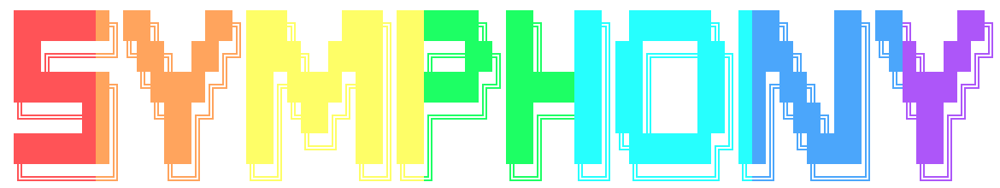

<p align="center">
  
</p>

# Zeron Symphony

A native Rust/GPUI desktop workspace for the [Symphony coding agent](https://github.com/Sarthakischauhan/symphony). Zeron owns the chat UI, workspace, terminal, browser, diffs, and optional device sync. Symphony owns model execution, tools, skills, plugins, approvals, and checkpoints.

Symphony is the only production runtime. This fork does not bundle or install Claude Code, Codex, Cursor, OpenCode, or ACP agent adapters. OpenAI, Anthropic, Gemini, Grok, and other models are selected through Symphony's provider catalog.

## Build and run

Requirements: Python 3.11+, [uv](https://docs.astral.sh/uv/), a stable Rust toolchain, and your platform's GPUI build dependencies. Linux's embedded browser needs [WebKitGTK 4.1 and JSON-GLib](docs/reference/linux-browser.md); Windows setup is documented [here](docs/reference/windows-development.md).

Clone the current main branches side by side:

```bash
git clone https://github.com/Sarthakischauhan/zeron-symphony.git
git clone https://github.com/Sarthakischauhan/symphony.git
cd symphony
uv sync --all-packages
cd ../zeron-symphony
export SYMPHONY_EXECUTABLE="$(cd ../symphony && pwd)/.venv/bin/symphony"
cargo build --release --locked -p zeron
./target/release/zeron
```

Use a Symphony installation that supports version 2 of `symphony stdio`. Set provider credentials in the environment that starts the engine, or use the Symphony provider accounts in Settings. `SYMPHONY_ROOT` can explicitly select a checkout containing `.symphony/config.json`. Install Symphony separately on every machine that hosts an engine, including remote/headless hosts.

## Documentation

- [Integration and setup](docs/symphony.md)
- [Provider accounts](docs/reference/symphony-accounts.md)
- [Slash commands](docs/reference/symphony-commands.md)
- [Architecture](ARCHITECTURE.md)
- [Documentation index](docs/README.md)

## Validation

```bash
cargo test --locked -p zeron-harness
cargo test --locked -p zeron-engine --lib
cargo test --locked -p zeron-engine --test symphony_accounts --test symphony_accounts_rpc
cargo test --locked -p zeron-doc
cargo test --locked -p zeron-ui --lib
```

UI tests need the platform build dependencies. The scripted mock harness remains for engine and UI tests; it is absent from the production runtime picker.

## License

[MIT](LICENSE). Upstream attribution remains in [THIRD_PARTY_NOTICES.md](THIRD_PARTY_NOTICES.md) and [CONTRIBUTORS.md](CONTRIBUTORS.md).
